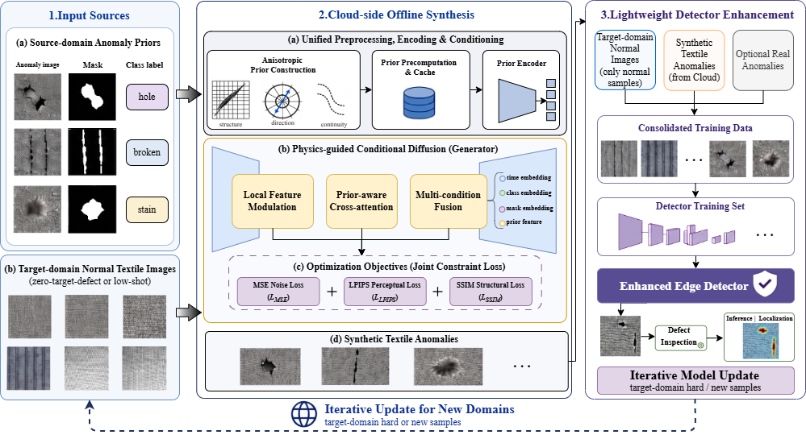

# Anisotropy-Guided Defect Synthesis

This repository contains the code for **Anisotropy-Guided Zero-Target-Defect Anomaly Synthesis for Resource-Constrained Textile Inspection in Industrial IoT**.

The method uses external defect images and masks to synthesize labeled defects on normal images of a target fabric. The generated image–mask pairs provide pixel-level supervision for a line-specific U-Net when real target defects are unavailable or scarce. The generator runs offline, and the detector handles online inspection.

## Framework

*Figure 1 from the paper. LFM denotes local feature modulation, GCAM denotes global cross-attention modulation, and JCL denotes joint constraint loss.*

## Contributions

- **Zero-target-defect synthesis for textile inspection.** External defect priors are transferred to normal target textiles to construct paired images and pixel masks before real defects from the target line are available for training.
- **Explicit anisotropic conditioning.** The five-channel prior encodes local axial direction, two directional scales, and coherence. LFM uses the encoded prior to scale and shift local denoising features, and GCAM uses it to condition bottleneck cross-attention. The generator composites the synthesized defect with the target-normal background within the transferred mask.
- **Matched evaluation and detector deployment.** The paper evaluates equal-budget synthesis against DDIM in zero-target-defect and few-shot textile settings. The generator is used during offline preparation, and synthesis leaves the U-Net inference architecture unchanged.

## Setup

Use Python 3.10 or newer with PyTorch and torchvision. For GPU support, select a PyTorch build that matches the CUDA environment. From the repository root, install the dependencies and check the imports.

~~~bash
python -m pip install torch torchvision numpy pillow opencv-python
python -c "import aniso_fields, diffusion, unet, localization_data, localization_train, localization_infer"
~~~

## Experimental protocol in the paper

Adjust the data loader to match the train/test split for each experiment.

### 1. Textile localization

Line01 and Line02 each use 70 normal images for detector training and target backgrounds. The same held-out split is used for all methods on a line, with 30 normal images and 50 real defect images with pixel masks. Zero-target-defect means that no real defects from the target line are used during training.

| Setting | Real target defects used in training | Generated pairs | Comparison |
| --- | ---: | ---: | --- |
| Zero-target-defect | 0 | 1,300 per line for each synthesis method | PatchCore uses normal images only. DDIM and Ours share the external defect sources, backgrounds, detector, and generation budget. |
| Few shot | 5, 10, or 20 per line | 200 per line and shot level for DDIM and Ours | Base trains on normals and real shots. DDIM and Ours use the same real shots to train their generators and add synthetic pairs to detector training. |

The zero-target-defect generator checkpoint is shared across both lines. Its external sources are MVTec AD carpet/color, carpet/cut, carpet/hole, carpet/thread, tile/crack, and wood/color, and factory sources TEST01, TEST02, TEST03, TEST11, TEST12, TEST15, and TEST32. In the few-shot setting, generators are trained separately by line with the same settings. Each line has its own detector in both settings.

### 2. Training and evaluation

| Component | Paper settings |
| --- | --- |
| Prior construction | Gaussian–Sobel structure tensor with Gaussian scales 1 and 1.5, 16 × 16 patches, 5% minimum mask coverage, and a coherence threshold of 0.05. |
| Diffusion generator | 256 × 256 RGB inputs, U-Net base width 128, dropout 0.1, 1,000 diffusion steps with a linear noise schedule from `1e-4` to `1e-2`, and 600 DDIM sampling steps. AdamW uses learning rate and weight decay `1e-4`, batch size 4, and 2,000 training epochs. |
| Generator objective | Guided variants use coherence-weighted noise MSE and LPIPS (weight 0.1). JCL adds masked SSIM loss (0.1), masked Lab color loss (0.1), and mask supervision (1.0, with equal BCE and Dice weights). |
| Textile detector | 3 input channels, 2 output channels, base width 40, and focal loss. Adam uses learning rate `1e-4` and batch size 32. Each of the 80 epochs draws 80 normal and 80 anomalous samples with replacement. Evaluation uses the fixed epoch-80 checkpoint. |
| Textile reporting | Pixel-level AUROC, AP, and PRO. Report the mean and sample standard deviation over seeds 0, 1, and 2, with the test split, real-shot lists, and method-specific synthetic pools held fixed. |

## Data availability

We will release the Line01, Line02, and factory-collected source datasets later.
